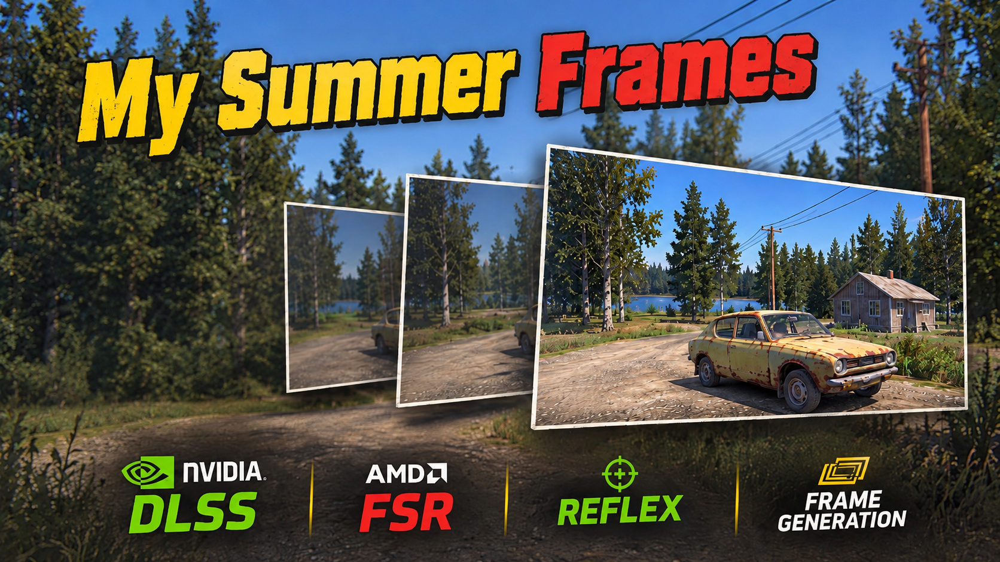

<p align="center">
  
</p>

<p align="center">
  <b>NVIDIA DLSS, AMD FSR, Frame Generation and NVIDIA Reflex for My Summer Car</b><br>
  An MSCLoader mod by ANICKON
</p>

<p align="center">
  <a href="https://github.com/ANICKONS/My-Summer-Frames/releases"></a>
  
  
  
  <a href="LICENSE"></a>
</p>

---

My Summer Car runs on Unity 5.0 and Direct3D 11, years older than any modern upscaler. My Summer Frames adds them to the game:
it renders the player's camera at a lower resolution (or at native resolution for anti-aliasing), computes motion vectors from
the depth buffer, and hands the frame to NVIDIA DLSS or AMD FSR. Frame generation runs on a Direct3D 12 bridge next to the
game's own Direct3D 11 device.

## Features

| | |
|---|---|
| **DLAA / DLSS Super Resolution** | NVIDIA DLSS on the game's own D3D11 device: DLAA, Quality, Balanced, Performance, Ultra Performance |
| **AMD FSR** | FSR SDK 2.4 (FSR 3.1 or FSR 4, chosen by the SDK for your card): Native AA, Quality, Balanced, Performance, Ultra Performance |
| **Sharpness** | 0 to 100 %. FSR uses its own RCAS; for DLSS the mod runs its own RCAS pass after the upscaler |
| **DLSS Frame Generation** | 2x on RTX 40, up to 6x (Multi Frame Generation) on RTX 50 |
| **FSR Frame Generation** | 2x on any DirectX 12 card, including GeForce GTX, Radeon and Intel Arc |
| **NVIDIA Reflex** | Off / On / On + Boost, with the driver's latency report in the console |
| **Settings page** | In the MSCLoader mod menu, in English and Russian, applied live without a restart |
| **Console** | Command `msf`: status, every setting, diagnostics |

The crosshair, the HUD and the hands stay sharp at full resolution in every mode. The mod's camera rays stay exact, so picking
up and using objects works as in the vanilla game.

## What works on which card

| Graphics card | Upscaler | Frame generation | Reflex |
|---|---|---|---|
| GeForce RTX 50 | DLSS or FSR | DLSS FG 2x to 6x, or FSR FG 2x | yes |
| GeForce RTX 40 | DLSS or FSR | DLSS FG 2x, or FSR FG 2x | yes |
| GeForce RTX 20 / 30 | DLSS or FSR | FSR FG 2x | yes |
| GeForce GTX 900 and newer | FSR 3.1 | FSR FG 2x | yes |
| Radeon RX 6000 / 7000 / 9000 | FSR 4 (FSR 3.1 on Windows 10) | FSR FG 2x | no |
| Radeon RX 5000 and older, Intel Arc | FSR 3.1 | FSR FG 2x | no |

Choosing DLSS without an RTX card switches to FSR, and DLSS FG without an RTX 40/50 switches to FSR FG; the console says so.
The settings page shows what your card supports. Tested on an RTX 5070 Ti; FSR 4 on Radeon has not been tested yet.

## Installation

1. Install [MSCLoader](https://github.com/piotrulos/MSCModLoader) 1.4.2 or newer.
2. Download the latest release and extract it into the game folder, so that you get:
   ```
   My Summer Car\Mods\MySummerFrames.dll
   My Summer Car\Mods\Assets\MySummerFrames\   (msf_core.dll, the DLSS and FSR libraries)
   ```
3. Start the game. The mod copies its native core into `mysummercar_Data\Plugins` by itself; on the very first start the game
   may need one restart for it to load (the console tells you).
4. Open **Mods → My Summer Frames → Settings** and choose the upscaler, the frame generation and Reflex.

> [!IMPORTANT]
> Frame generation needs a window: windowed mode or a borderless window (Steam launch option `-popupwindow`).
> In exclusive fullscreen it stays off.

If you used the earlier test builds called **MSCDLSS**, delete `Mods\MSCDLSS.dll`, `Mods\Assets\MSCDLSS` and
`mysummercar_Data\Plugins\mscdlss_ngx.dll` first, otherwise both copies run.

## Performance

My Summer Car is limited by the CPU: on an RTX 5070 Ti at 2560x1440 the graphics card is busy for about 2 ms of a 12 ms frame.
Upscaling saves GPU time, so it helps on slower graphics cards and at 4K, and costs nothing on fast ones. DLAA gives better
anti-aliasing than the game's FXAA at almost the same frame rate (81.8 → 80.6 fps in the yard).

Frame generation adds shown frames even when the CPU is the limit (real + generated frames per second):

| Mode | Result |
|---|---|
| DLSS FG 2x / 3x / 4x / 6x (1280x720) | 65 + 65 / 77 + 154 / 73 + 217 / 76 + 378 |
| DLAA + FSR FG 2x (2560x1440) | 84 + 84, the desktop showed 161 to 171 frames per second |

## Console

```
msf status                      what is on, what the card supports
msf mode off|dlaa|quality|balanced|performance|ultra     DLSS
msf fsr off|native|quality|balanced|performance|ultra    FSR
msf sharpness 0..10             sharpening in tenths
msf fg off|2..6|fsr             DLSS frame generation (2x to 6x) or FSR frame generation
msf reflex off|on|boost|stats   Reflex, and the driver's latency report
msf verbose on|off              the detailed log in the console
```

The full log is in `Mods\Config\Mod Settings\MySummerFrames\msf.log`.

## Known limitations

- Changing UI (the MSCLoader console, HUD numbers) can double in generated frames.
- The game's own effects (fog, sun shafts, tonemapping) run at the render resolution, before the upscaler.
- FSR frame generation is 2x only; the FSR SDK expects the game to run at 60 fps or more (FSR FG 4: 30 or more).
- Reflex does not count the frame generation bridge's own latency.

## Building from source

Requirements: Visual Studio Build Tools with C++ (MSVC, Windows SDK), the .NET SDK, git, and the game with MSCLoader.

```powershell
.\build.ps1                     # native core + mod into out\ (the SDKs are fetched into _sdk\ on the first build)
.\build.ps1 -GameDir "D:\Games\My Summer Car"
```

The NVIDIA DLSS SDK, NVAPI and the AMD FSR SDK are downloaded on the first build and never committed. The repository also
contains the development test harness: `scripts\run.ps1` installs the build into the game for one automated session with the
TestBot (`tests\TestBot`, scenarios in `tests\scenarios`), backs up and restores the save, the settings and the player's own
installation of the mod. How the mod works inside: [docs/DESIGN.ru.md](docs/DESIGN.ru.md) (in Russian).

## Credits and third-party components

- **NVIDIA DLSS SDK** (DLSS Super Resolution, DLSS Frame Generation): `nvngx_dlss.dll` and `nvngx_dlssg.dll` are shipped in the
  release under the NVIDIA RTX SDKs license.
- **NVIDIA NVAPI** (Reflex), MIT license.
- **AMD FidelityFX SDK** (FSR upscaling, FSR frame generation): the signed `amd_fidelityfx_*_dx12.dll` files are shipped in the
  release with their license (`AMD_FSR_LICENSE.txt`, MIT). The RCAS sharpening pass for DLSS follows AMD's FSR 1 RCAS (MIT).
- [MSCLoader](https://github.com/piotrulos/MSCModLoader) by piotrulos.

NVIDIA, GeForce, RTX, DLSS and Reflex are trademarks of NVIDIA Corporation. AMD, Radeon, FidelityFX and FSR are trademarks of
Advanced Micro Devices, Inc. My Summer Car is a game by Amistech Games. This mod is not affiliated with or endorsed by any of them.

## Author

**ANICKON**, also the author of [MOP - REVIVAL](https://github.com/ANICKONS/MOP-REVIVAL). Contains AI-assisted code.

Licensed under the [MIT license](LICENSE).
